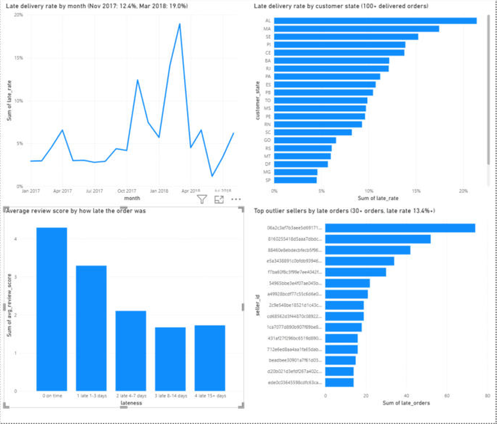

# Shipment Delay Lakehouse

A Databricks lakehouse (Delta Lake, bronze / silver / gold) that finds what drives late deliveries on an e-commerce marketplace and what late deliveries cost in customer reviews. It ends in a Tableau Public dashboard and a Power BI version, a statistical analysis and a recommendation for the operations manager.

**Status:** analysis and dashboards (Tableau Public, Power BI) complete; report-generator agent (text-to-SQL, evaluated) complete; weekly brief ready to schedule

## Business problem
Marketplace operations cannot see which sellers, regions or periods cause late deliveries, and late deliveries hurt review scores and repeat purchases.

- **Stakeholder:** logistics / marketplace operations manager
- **Decision:** where to coach sellers, fix carrier lanes, and adjust delivery promises
- **Metrics:** late rate (delivered after the estimated date, compared by calendar date), days late, review score

## Key findings
| Finding | Result |
| --- | --- |
| Delivered orders analysed | 96,470 (orders with a delivery date) |
| Overall late rate | 6.8% (average delivery 12.5 days) |
| Review score, on time vs late | 4.29 vs 2.27 stars; gap 2.02 (95% CI 1.98 to 2.06) |
| 1-star reviews, on time vs late | 6.6% vs 53.8% |
| Damage saturates after about a week | 1-3 days late: 3.29 stars; 4-7 days: 2.10; 8-14 days: 1.67; 15+ days: 1.72 |
| Peak season (Nov-Dec) vs other months | 10.3% vs 6.2% late (odds ratio 1.74, 95% CI 1.63 to 1.85) |
| Worst months | Nov 2017: 12.4% (904 of 7,288 orders); Feb 2018: 14.1%; Mar 2018: 18.96% (cause not identified from this data) |
| Worst states by late rate | AL 21.4%, MA 17.4%, SE 15.2%, PI 13.9%, CE 13.8%, BA 12.2%, RJ 12.1% |
| Biggest state by late volume | RJ: about 1,495 late orders, roughly a quarter of all late orders |
| Seller concentration | 53 sellers (at least 30 orders and at least twice the overall late rate) ship 4.4% of orders but cause 11.2% of late deliveries; matching the average would avoid about 442 late orders (6.8% of all) |

Late and on-time orders differ in more than lateness, so the review gap is an association, not proof of causation.

## What drives lateness
Logistic regression on 95,978 orders (odds ratios, 95% CI):

| Factor | Odds ratio | 95% CI | Note |
| --- | --- | --- | --- |
| Peak season (Nov-Dec) | 1.74 | 1.63 to 1.85 | Largest effect; only one real peak in the data |
| Distance (per 100 km) | 1.04 | 1.04 to 1.05 | Real but modest |
| Package weight (per kg) | 1.02 | 1.01 to 1.03 | Small |
| Order value (log) | 1.07 | 1.03 to 1.11 | Small |
| Freight ratio | 1.09 | 0.99 to 1.20 | Not significant (p = 0.096) |
| Multi-seller order | 0.14 | 0.08 to 0.24 | Implausibly protective; few such orders; not interpreted |

Pseudo R-squared is 0.019: order attributes explain very little. Lateness is mostly seller-, carrier- and region-specific, and seasonal.

## Is it a promise problem? (ETA check)
- Average promises are already generous: Alagoas (AL) promised 33.2 days vs 24.5 actual, yet 21% of orders are late. The problem is the long tail: the 95th-percentile delay is 9 to 13 days in the worst states (AL, MA, CE 13; SE, RJ 12; PA 10; PI, BA 9).
- Padding the ETA is not the fix: reaching 95% on time in AL would need about 13 extra days on a 33-day promise.
- Peak season was a promise failure: Nov 2017 average promise stayed at 23.2 days (Oct: 23.7) while actual delivery rose from 11.7 to 15.1 days.

| Period | Orders | Avg promised days | Avg actual days | Late rate | 95th pct delay (days) |
| --- | --- | --- | --- | --- | --- |
| Other months | 83,668 | 24.2 | 12.1 | 6.2% | 2 |
| Peak (Nov-Dec) | 12,802 | 25.4 | 15.2 | 10.3% | 7 |

## Recommendations
1. **Peak-season promise and capacity:** widen the promise dynamically in Nov-Dec and add carrier capacity; the last peak was not adjusted for.
2. **Tail-risk control in high-delay states:** escalate orders still in transit past a threshold and set carrier SLAs for AL, MA, CE, SE, BA and RJ lanes.
3. **Seller coaching:** the 53 outlier sellers are a quick win (about 442 avoidable late orders) but only about 7% of the problem.

## Data
[Olist Brazilian E-Commerce Public Dataset](https://www.kaggle.com/datasets/olistbr/brazilian-ecommerce): 9 CSV files, about 100K orders, 2016 to 2018. A proxy for a mid-size marketplace, so findings are illustrative.

### Bronze row counts
| Table | Rows |
| --- | --- |
| bronze_customers | 99,441 |
| bronze_geolocation | 1,000,163 |
| bronze_order_items | 112,650 |
| bronze_order_payments | 103,886 |
| bronze_order_reviews | 99,224 |
| bronze_orders | 99,441 |
| bronze_products | 32,951 |
| bronze_sellers | 3,095 |
| bronze_category_translation | 71 |

### Data quality findings (silver layer, 22 checks logged to `silver_dq_log`)
| Table | Issue | Count | Handling |
| --- | --- | --- | --- |
| orders | Status not delivered | 2,963 | Kept, flagged `is_delivered = false` |
| orders | Delivered but no delivery date | 8 | Kept, flagged |
| orders | Carrier pickup date before purchase | 166 | Kept, reviewed in analysis |
| products | Missing category | 610 | Set to `unknown` |
| products | Category with no English translation | 2 | Fall back to Portuguese name |
| reviews | `review_id` repeated | 814 | One review per order |
| reviews | Orders with more than one review | 547 | Kept the latest |
| payments | Value of 0 or less | 9 | Flagged |
| geolocation | Exact duplicate rows | 261,831 | Collapsed to 19,015 zip prefixes |

No orphan keys, duplicate IDs or invalid prices were found.

## Architecture
- **Bronze:** raw CSVs as Delta tables (all strings) with `ingested_at` and `source_file`
- **Silver:** typed, deduplicated, standardized tables plus delay columns (`delivery_days`, `delay_days`, `is_late`) and a data-quality log
- **Gold:** star schema (`dim_customer`, `dim_seller`, `dim_product`, `fact_orders`, `fact_order_items`) and KPI tables (seller, state, category, month, review-by-lateness, ETA gap)
- **Serving:** Tableau Public dashboard and a Power BI version, built from exported KPI tables
- **Agent:** guardrailed text-to-SQL report agent and a weekly executive brief over the gold tables

## Dashboards
- Tableau Public: [Shipment Delay Lakehouse dashboard](https://public.tableau.com/app/profile/rutwij.thorat/viz/ShipmentDelayLakehouse/Dashboard1)
  - Monthly late rate, with the Nov 2017 (12.4%) and Mar 2018 (18.96%) peaks annotated
  - Late rate by customer state (states with 100+ delivered orders)
  - Average review score by how late the order was
  - The 15 outlier sellers with the most late orders (30+ orders and a late rate of 13.4% or more)
- Power BI: the same four views, built from the exported KPI tables. Report file: [docs/shipment_delay_lakehouse.pbix](docs/shipment_delay_lakehouse.pbix) (open in Power BI Desktop); screenshot below

## Report agent (text-to-SQL over the gold tables)
Ask a business question in plain English; the agent writes the SQL, runs it read-only, and answers using only the numbers returned. The SQL is shown with every answer so a person can audit it.

- **Flow:** question -> LLM writes Spark SQL from the live table schema -> guardrail validator -> run -> one repair retry on error -> short answer written from the result rows -> faithfulness check (every number in the answer must exist in the result)
- **Guardrails:** one SELECT/WITH statement only; writes, DDL and multiple statements are rejected; only the 11 gold tables are allow-listed; a row limit is added automatically
- **Model:** Llama 3.3 70B (Databricks-hosted, called with `ai_query`, temperature 0). Free Edition does not allow the premium Claude/GPT endpoints.
- **Weekly brief:** `09_weekly_brief.py` builds an executive summary from fixed, reviewed SQL (not model-written SQL) so a scheduled report is deterministic; the model only writes the narrative, and the same faithfulness check runs on it. Written and ready to schedule as a Databricks job; not yet scheduled.

### Evaluation
40 business questions (15 easy, 15 medium, 10 hard), each with a hand-written reference query. An answer counts as correct when its *result* matches the reference result (different SQL that returns the same answer is fine). Full detail in [docs/agent_evaluation.md](docs/agent_evaluation.md).

| | Run 1 (baseline) | Run 2 (after fixes) |
| --- | --- | --- |
| Execution accuracy, 40 questions | 57.5% (23/40) | 82.5% (33/40) |
| Easy / medium / hard | 47% / 87% / 30% | 87% / 93% / 60% |
| Valid SQL | 95% | 100% |
| Answer faithfulness | 45% | 84% |
| Held-out set (10 new questions, never used for tuning) | not run | 10/10 |

- **What the baseline showed:** most misses were fixable. The model formatted rates as text (`CONCAT(ROUND(...))`), then sorted by that text and returned the wrong state; it multiplied by 100 inconsistently; my validator wrongly rejected `EXTRACT(YEAR FROM month)`; and my faithfulness check counted numbers from the question itself as invented.
- **What I changed:** prompt rules (raw numeric output, no aliases that shadow columns, count orders with `COUNT(DISTINCT order_id)`, rank in a subquery), the validator, and the faithfulness check. Because that used the same 40 questions, I wrote 10 held-out questions afterwards as the cleaner estimate. Ten questions is a small sample (10/10 is consistent with a true rate anywhere above roughly 70%), so treat it as a sanity check, not a guarantee.
- **Remaining 7 misses (run 2):** three are genuine reasoning errors (two rate questions where the model divided a count by itself and returned 100%, and one sign error on "lower by"); one is an ambiguous reference (order-level vs item-level average delivery days, where the model's choice is defensible); three return the right values but in a different shape or date format (two of these are a scorer issue, fixed in the notebook but not re-run).
- **Guardrail test:** 6 adversarial prompts (drop, delete, update, create, a prompt-injection attempt, and a request for a non-gold table). Five were stopped by the validator. The sixth ("show me the silver_customers table") passed the validator because the model answered from an allowed table instead. No gold table changed (row counts identical before and after).

## Notebooks (run in order)
1. `notebooks/01_bronze_ingest.py`
2. `notebooks/02_silver_clean.py`
3. `notebooks/03_gold_model.py`
4. `notebooks/04_delay_analysis.py`
5. `notebooks/05_eta_check.py`
6. `notebooks/06_export_for_dashboards.py`
7. `notebooks/07_agent_core.py` (agent definitions; run through 08)
8. `notebooks/08_agent_eval.py` (demo, 40-question evaluation, held-out set, guardrail test)
9. `notebooks/09_weekly_brief.py` (weekly executive brief)

Set `CATALOG`, `SCHEMA` and `VOLUME` at the top of each notebook (defaults: `workspace`, `olist`, `raw`).

## Limitations
- Proxy dataset from one marketplace; findings are illustrative, not company data.
- Associations, not causal effects.
- Only one real peak season (Nov 2017), so season is confounded with fast growth.
- The Feb and Mar 2018 spikes are unexplained.
- Data ends in August 2018, so the last months are incomplete and their low late rates should not be read as improvement.
- Seller-customer distance uses zip-prefix centroids, so it is approximate.
- Only delivered orders with a delivery date are in the late-rate figures.
- Agent evaluation: one author wrote the questions and reference queries, one run per version at temperature 0, held-out set of only 10; the SQL validator is regex-based (production protection should be a read-only role with grants on the gold tables only).

## Tech
Databricks (serverless), Delta Lake, PySpark, Spark SQL, statsmodels, Databricks Foundation Model API (Llama 3.3 70B via ai_query), Tableau Public, Power BI

## Next
Re-run the evaluation with the fixed scorer; schedule the weekly brief as a Databricks job; run the agent under a read-only role limited to the gold tables.
